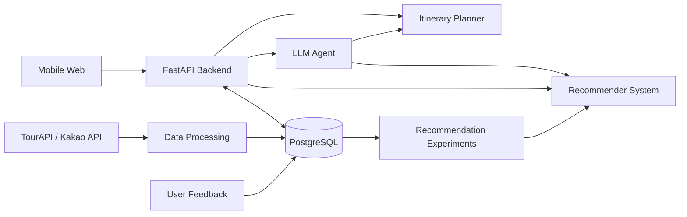

# TravelSync

**취향은 달라도 일정은 하나로: 그룹 여행 갈등 해결 플래너**  
*Different tastes, one itinerary.*

TravelSync는 친구들의 날짜, 예산, 여행 취향과 필수 조건을 모아  
**그룹 전체가 만족할 수 있는 여행 장소와 일정을 추천하는 플랫폼**입니다.

인하대학교 컴퓨터공학 종합설계 · 2026학년도 2학기  
**6조 Ourney (Our Journey)**

---

## 현재 상태

> **2026.09.30 / 6주차**

- ✅ 주제 및 서비스 범위 확정
- ✅ 전체 시스템 아키텍처 설계
- ✅ 주요 UI/UX 프로토타입 제작
- ✅ TourAPI / Kakao Local API 장소 데이터 수집 시작
- 🔄 장소 데이터 정제 및 특징(feature) 구성
- 🔄 추천 시스템 알고리즘 조사 및 비교
- ⬜ 추천 시스템 v1 구현
- ⬜ 백엔드 / DB / 프론트엔드 연동
- ⬜ LLM 일정 조율 Agent 구현
- ⬜ 통합 테스트 및 사용자 평가

**목표: 11주차까지 핵심 사용자 흐름을 시연할 수 있는 통합 데모 완성**

---

## 핵심 기능

| 기능 | 설명 |
| --- | --- |
| 여행방 | 친구 초대 및 여행 조건 관리 |
| 날짜·예산 조율 | 가능한 날짜와 예산 범위 확인 |
| 취향 입력 | 활동별 선호도 + Hard Constraint 입력 |
| 그룹 추천 | 여러 사용자의 취향을 반영한 POI 추천 |
| 일정 생성 | 추천 장소를 이용해 2–3개 일정 후보 생성 |
| 투표 | 그룹이 일정 후보를 비교하고 선택 |
| AI Agent | 채팅 요청을 이해하고 일정 변경안 제안 |
| 피드백 | 여행 후 평가를 추천 시스템 개선에 활용 |

---

## Setup (Windows PowerShell)

Use Python **3.13.14**. From the project root, create and activate a virtual environment:

```powershell
py -3.13 -m venv .venv
.\.venv\Scripts\Activate.ps1
```

Install the project dependencies:

```powershell
python -m pip install -r requirements.txt
```

Verify the installations:

```powershell
python --version
dvc --version
mlflow --version
```

To start the local MLflow server:

```powershell
mlflow server
```

---

## Recommender System

The current implementation is a rule-based, content-based baseline:

```text
User 10D Preference (1-5)
       -> POI 10D Binary Features
       -> Individual Scoring
       -> Candidate Generation (union of each member's top-N)
       -> Group Aggregation / GFAR
       -> Top-K POIs
```

Both vectors use this exact feature order:

```text
food, cafe, nature, history, art, shopping, activity, entertainment, relax, festival
```

POI features are independent binary labels. A POI can have several labels and
must have at least one. The raw binary vectors are retained. Individual scores
are `dot(user_preferences, poi_features) / sum(poi_features)`: the mean survey
preference over active labels, on the original 1-5 scale. This avoids a label-count
bonus and lets Average Without Misery use a threshold on the same scale.
No survey rescaling or soft feature inference is applied.

Candidates are the union of each member's top-N results (default 100 per member).
All member scores remain aligned for every candidate. Ties preserve CSV row order.
GFAR is the default group aggregator; its Borda relevance depth is separately
configured (default 20). `AverageWithoutMisery` remains the comparison baseline.
GFAR is a starter implementation that still needs validation against the authors'
implementation. `FeatureAGREE` is an untrained experimental skeleton; its code,
package export, and test are commented out pending further model work.
GFAR scores are marginal gains;
AWM scores are mean preferences, so scores cannot be compared across models.

```python
from ourney_travelsync import FEATURE_NAMES, load_places, AverageWithoutMisery
from ourney_travelsync.RecSys import recommend_group

places = load_places()  # package-relative travelsync_final_places.csv
users = {
    "alice": dict(zip(FEATURE_NAMES, [5, 4, 3, 2, 4, 2, 3, 3, 4, 1])),
    "bob": dict(zip(FEATURE_NAMES, [3, 2, 5, 4, 3, 2, 4, 2, 5, 3])),
}
results = recommend_group(places, users, top_k=10, individual_top_n=100)
# Comparison baseline:
awm = recommend_group(places, users, recommender=AverageWithoutMisery(2.5))
metadata = {row["place_id"]: row for row in places.records}
for result in results:
    print(metadata[result.poi_id]["place_name"], result.score)
```

Explicit `excluded_place_ids` and externally determined `eligible_place_ids` are
applied before scoring and candidate generation. Budget, dates, movement limits
and mandatory exclusions are separate hard constraints, never vector dimensions.
Price/opening-hour/date availability filtering is deferred until those fields
exist. The current pipeline does not infer them from categories or names.

Run regression checks from the repository root after dependency installation:

```powershell
$env:PYTHONPATH = "src"
python -m unittest discover -s tests -v
```

Evaluation should compare individual ranking, group mean/minimum satisfaction,
between-member satisfaction gaps and hard-constraint violations. Ground-truth
Precision@K/NDCG@K need collected relevance labels or feedback.

---

## System Architecture



---

## Tech Stack

| 영역 | 기술 |
| --- | --- |
| Frontend | React, TypeScript, Vite |
| Backend | Python, FastAPI |
| Database | PostgreSQL |
| Data | pandas, TourAPI, Kakao Local API |
| Recommender | Python, NumPy, pandas, scikit-learn + TBD |
| AI Agent | OpenAI API |
| MLOps | MLflow, DVC, GitHub Actions |
| Deployment | Docker, AWS |

기술 스택은 구현 과정에서 변경될 수 있습니다.

---

## Data

The final Busan POI dataset is
`src/ourney_travelsync/travelsync_final_places.csv`: **3,591 POIs**, consisting of
3,101 Kakao, 367 TourAPI, and 123 merged TourAPI+Kakao records.

The core inputs are `place_id`, `place_name`, `category_name`, `latitude`,
`longitude` and the ten binary features. Rule-based mapping uses TourAPI
`contenttypeid`/`cat1`/`cat2`/`cat3`, Kakao `category_name`, and auxiliary place-name
keywords. This final CSV exposes the TourAPI content type as `category`.
`feature_rules` preserves classification provenance and is retained as metadata,
not used as an embedding input. The loader validates the supplied labels instead
of regenerating them.

The final dataset already uses conservative deduplication based on normalized
names, coordinate distance, name similarity and category compatibility. Ambiguous
pairs remain separate; the recommendation loader does not merge them again.

Description/overview, opening hours, closing days, prices and expected dwell
times are currently unavailable. Sentence Transformer is deferred. After checking
TourAPI overview coverage, future experiments can compare the rule-based baseline,
Sentence Transformer soft features and hybrid features, and add constraints for
newly collected operational data.

---

## Development Plan

### Now — Week 6

- 추천 알고리즘 후보 조사
- 논문 및 기존 실험 비교
- POI 데이터 전처리
- Baseline recommender 구현

### Next

- 최종 추천 알고리즘 선택
- 그룹 추천 구현
- Backend / DB / UI 연결
- 일정 생성 및 투표 기능 구현
- LLM Agent 연동

### Week 10–11

- 통합 테스트
- 사용자 평가
- 추천 모델 비교 실험
- 최종 Demo

---

## Team

| 팀원 | 담당 |
| --- | --- |
| 임재훈 | Data / POI |
| 바트에르덴 | 개발 역할 진행 상황에 따라 업데이트 |
| 오리항 | AI / Recommender System |

---

## Repository

프로젝트 진행에 따라 아래 항목을 업데이트합니다.

```text
README.md        ← 프로젝트 상태
frontend/        ← Web application
backend/         ← API / Database
recommender/     ← Recommendation models
data/            ← Data processing
experiments/     ← Algorithm experiments
```

API Key와 개인정보는 repository에 commit하지 않습니다.

---

## License

프로젝트 라이선스는 추후 결정합니다.  
외부 API 및 데이터에는 각 제공처의 이용 조건이 적용됩니다.