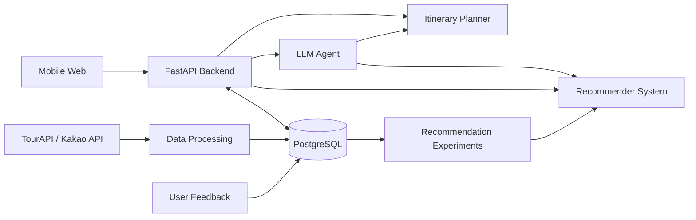

# TravelSync

**취향은 달라도 일정은 하나로: 그룹 여행 갈등 해결 플래너**  
*Different tastes, one itinerary.*

TravelSync는 친구들의 날짜, 예산, 여행 취향과 필수 조건을 모아  
**그룹 전체가 만족할 수 있는 여행 장소와 일정을 추천하는 플랫폼**입니다.

인하대학교 컴퓨터공학 종합설계 · 2026학년도 2학기  
**6조 Ourney (Our Journey)**

---

## 현재 상태

> **2026.09.30 / 6주차**

- ✅ 주제 및 서비스 범위 확정
- ✅ 전체 시스템 아키텍처 설계
- ✅ 주요 UI/UX 프로토타입 제작
- ✅ TourAPI / Kakao Local API 장소 데이터 수집 시작
- 🔄 장소 데이터 정제 및 특징(feature) 구성
- 🔄 추천 시스템 알고리즘 조사 및 비교
- ⬜ 추천 시스템 v1 구현
- ⬜ 백엔드 / DB / 프론트엔드 연동
- ⬜ LLM 일정 조율 Agent 구현
- ⬜ 통합 테스트 및 사용자 평가

**목표: 11주차까지 핵심 사용자 흐름을 시연할 수 있는 통합 데모 완성**

---

## 핵심 기능

| 기능 | 설명 |
| --- | --- |
| 여행방 | 친구 초대 및 여행 조건 관리 |
| 날짜·예산 조율 | 가능한 날짜와 예산 범위 확인 |
| 취향 입력 | 활동별 선호도 + Hard Constraint 입력 |
| 그룹 추천 | 여러 사용자의 취향을 반영한 POI 추천 |
| 일정 생성 | 추천 장소를 이용해 2–3개 일정 후보 생성 |
| 투표 | 그룹이 일정 후보를 비교하고 선택 |
| AI Agent | 채팅 요청을 이해하고 일정 변경안 제안 |
| 피드백 | 여행 후 평가를 추천 시스템 개선에 활용 |

---

## Setup (Windows PowerShell)

Use Python **3.13 or newer**. Open a terminal in the repository root (the folder
containing `pyproject.toml`) and create the environment:

```powershell
py -3.13 -m venv .venv
.\.venv\Scripts\python.exe -m pip install -e .
.\.venv\Scripts\python.exe -m pip install ipykernel
```

The editable installation makes `ourney_travelsync` importable and installs the
NumPy dependency. `ipykernel` lets VS Code run the notebook in this environment.
These commands use the environment's Python directly, so activation is optional.

For the additional data and experiment tools (DVC, MLflow, pandas and
scikit-learn), install:

```powershell
.\.venv\Scripts\python.exe -m pip install -r requirements.txt
.\.venv\Scripts\dvc.exe --version
.\.venv\Scripts\mlflow.exe --version
```

To start the local MLflow server:

```powershell
.\.venv\Scripts\mlflow.exe server
```

MLflow and DVC are optional for running the recommendation notebook.

---

## Recommender System

The current implementation is a rule-based, content-based baseline:

```text
User 10D Preference (1-5)
       -> POI 10D Binary Features
       -> Individual Scoring
       -> Candidate Generation (union of each member's top-N)
       -> Group Aggregation / GFAR
       -> Top-K POIs
```

Both vectors use this exact feature order:

```text
food, cafe, nature, history, art, shopping, activity, entertainment, relax, festival
```

POI features are independent binary labels. A POI can have several labels and
must have at least one. The raw binary vectors are retained. Individual scores
are `dot(user_preferences, poi_features) / sum(poi_features)`: the mean survey
preference over active labels, on the original 1-5 scale. This avoids a label-count
bonus and lets Average Without Misery use a threshold on the same scale.
No survey rescaling or soft feature inference is applied.

Candidates are the union of each member's top-N results (default 100 per member).
All member scores remain aligned for every candidate. Ties preserve CSV row order.
GFAR is the default group aggregator; its Borda relevance depth is separately
configured (default 20). `AverageWithoutMisery` remains the comparison baseline.
The current algorithms are **GFAR** and **Average Without Misery (AWM)**.
AWM rejects a POI if any member's score is below its threshold (default 2.5),
then ranks the remaining POIs by mean preference. GFAR balances relevance across
members as it builds the list. GFAR does not apply AWM's veto threshold.

### Run recommendations in VS Code

1. Complete the setup above and open the repository folder in VS Code.
2. Install the **Python** and **Jupyter** VS Code extensions if they are missing.
3. Open [test.ipynb](src/ourney_travelsync/RecSys/test.ipynb).
4. Click **Select Kernel** at the top right, then **Python Environments**, and
   select `.venv` (`.venv/Scripts/python.exe`).
5. Click **Run All** in the notebook toolbar.

The notebook loads the included POI CSV, creates example user preferences,
prints recommendations, and compares AWM with GFAR. No API keys or live data
collection are needed for this example.

To try your own group, edit the `user` and `users` definitions. Each member needs
all ten feature values in the order above, with preferences between 1 and 5.
In the comparison cell, adjust `comparison_top_k` (requested list size) and
`comparison_candidate_top_n` (candidate depth per member), then run the notebook
again. Change `AverageWithoutMisery(2.5)` to experiment with the veto threshold.

### Compare AWM and GFAR

The **AWM vs GFAR: shared satisfaction evaluation** section runs both algorithms
on the same scored candidate pool with the same requested top-K. It evaluates
selected POIs using the original member-POI preference scores:

| Metric | Calculation | Interpretation |
| --- | --- | --- |
| Mean satisfaction | Average of all members' average scores across returned POIs | Overall predicted preference; higher is better |
| Minimum member satisfaction | Lowest member average across returned POIs | Predicted preference of the least-satisfied member; higher is better |
| Returned POIs | Number of selected POIs | AWM may return fewer than the requested top-K |

The notebook also prints each member's average. Empty recommendation lists show
`N/A` for satisfaction. Minimum member satisfaction is the lowest **member
average**, not the lowest score for a single place.

For the included example (100 candidates per member, top-K 10), the comparison is:

| Algorithm | Returned POIs | Mean satisfaction | Minimum member satisfaction |
| --- | ---: | ---: | ---: |
| AWM | 10 | 4.500 | 4.000 |
| GFAR | 10 | 3.875 | 3.500 |

These results describe this example under the current category-based scoring
assumptions. Actual recommendation quality needs user feedback. AWM's output
score is a mean preference; GFAR's output score is a marginal gain. Compare the
shared satisfaction metrics instead of comparing or rescaling those raw outputs.

### Run recommendations from a Python script

Save the following as `recommend.py` in the repository root:

```python
from ourney_travelsync import FEATURE_NAMES, load_places, AverageWithoutMisery, GFAR
from ourney_travelsync.RecSys import prepare_group

places = load_places()
users = {
    "alice": dict(zip(FEATURE_NAMES, [4, 5, 3, 2, 2, 3, 3, 3, 4, 1])),
    "bob": dict(zip(FEATURE_NAMES, [3, 2, 5, 4, 3, 2, 4, 2, 5, 3])),
}
group = prepare_group(places, users, individual_top_n=100)
metadata = {row["place_id"]: row for row in places.records}

for name, model in {"AWM": AverageWithoutMisery(2.5), "GFAR": GFAR()}.items():
    results = model.recommend(group, top_k=10)
    print(f"\n{name}: {len(results)} POIs")
    for result in results:
        print(result.poi_id, metadata[result.poi_id]["place_name"])
```

Run it from the repository root:

```powershell
.\.venv\Scripts\python.exe recommend.py
```

Use package imports as shown above. Running a library file such as
`RecSys/IndividualScoring.py` directly causes
`ImportError: attempted relative import with no known parent package`.
The library files define functions and models; the notebook or your script calls
them to generate recommendations.

### Import and environment troubleshooting

- **`ModuleNotFoundError: ourney_travelsync` or `numpy`:** rerun the editable
  installation command with `.venv/Scripts/python.exe` and select the same
  environment as the notebook kernel. Restart the kernel and click **Run All**.
- **The `.venv` kernel is missing:** install `ipykernel` using the setup command,
  then select `.venv/Scripts/python.exe` through the kernel picker.
- **An existing environment is missing `.venv/pyvenv.cfg`:** recreate its
  configuration with `py -3.13 -m venv .venv`, then rerun the setup installation
  commands and restart the notebook kernel.

Explicit `excluded_place_ids` and externally determined `eligible_place_ids` are
applied before scoring and candidate generation. Budget, dates, movement limits
and mandatory exclusions are separate hard constraints, never vector dimensions.
Price/opening-hour/date availability filtering is deferred until those fields
exist. The current pipeline does not infer them from categories or names.

### Run regression checks

From the repository root after the editable installation:

```powershell
.\.venv\Scripts\python.exe -m unittest discover -s tests -v
```

Evaluation should compare individual ranking, group mean/minimum satisfaction,
between-member satisfaction gaps and hard-constraint violations. Ground-truth
Precision@K/NDCG@K need collected relevance labels or feedback.

---

## System Architecture



---

## Tech Stack

| 영역 | 기술 |
| --- | --- |
| Frontend | React, TypeScript, Vite |
| Backend | Python, FastAPI |
| Database | PostgreSQL |
| Data | pandas, TourAPI, Kakao Local API |
| Recommender | Python, NumPy, pandas, scikit-learn + TBD |
| AI Agent | OpenAI API |
| MLOps | MLflow, DVC, GitHub Actions |
| Deployment | Docker, AWS |

기술 스택은 구현 과정에서 변경될 수 있습니다.

---

## Data

The final Busan POI dataset is
`src/ourney_travelsync/travelsync_final_places.csv`: **3,591 POIs**, consisting of
3,101 Kakao, 367 TourAPI, and 123 merged TourAPI+Kakao records.

The core inputs are `place_id`, `place_name`, `category_name`, `latitude`,
`longitude` and the ten binary features. Rule-based mapping uses TourAPI
`contenttypeid`/`cat1`/`cat2`/`cat3`, Kakao `category_name`, and auxiliary place-name
keywords. This final CSV exposes the TourAPI content type as `category`.
`feature_rules` preserves classification provenance and is retained as metadata,
not used as an embedding input. The loader validates the supplied labels instead
of regenerating them.

The final dataset already uses conservative deduplication based on normalized
names, coordinate distance, name similarity and category compatibility. Ambiguous
pairs remain separate; the recommendation loader does not merge them again.

Description/overview, opening hours, closing days, prices and expected dwell
times are currently unavailable. Sentence Transformer is deferred. After checking
TourAPI overview coverage, future experiments can compare the rule-based baseline,
Sentence Transformer soft features and hybrid features, and add constraints for
newly collected operational data.

---

## Development Plan

### Now — Week 6

- 추천 알고리즘 후보 조사
- 논문 및 기존 실험 비교
- POI 데이터 전처리
- Baseline recommender 구현

### Next

- 최종 추천 알고리즘 선택
- 그룹 추천 구현
- Backend / DB / UI 연결
- 일정 생성 및 투표 기능 구현
- LLM Agent 연동

### Week 10–11

- 통합 테스트
- 사용자 평가
- 추천 모델 비교 실험
- 최종 Demo

---

## Team

| 팀원 | 담당 |
| --- | --- |
| 임재훈 | Data / POI |
| 바트에르덴 | 개발 역할 진행 상황에 따라 업데이트 |
| 오리항 | AI / Recommender System |

---

## Repository

프로젝트 진행에 따라 아래 항목을 업데이트합니다.

```text
README.md        ← 프로젝트 상태
frontend/        ← Web application
backend/         ← API / Database
recommender/     ← Recommendation models
data/            ← Data processing
experiments/     ← Algorithm experiments
```

API Key와 개인정보는 repository에 commit하지 않습니다.

---

## License

프로젝트 라이선스는 추후 결정합니다.  
외부 API 및 데이터에는 각 제공처의 이용 조건이 적용됩니다.